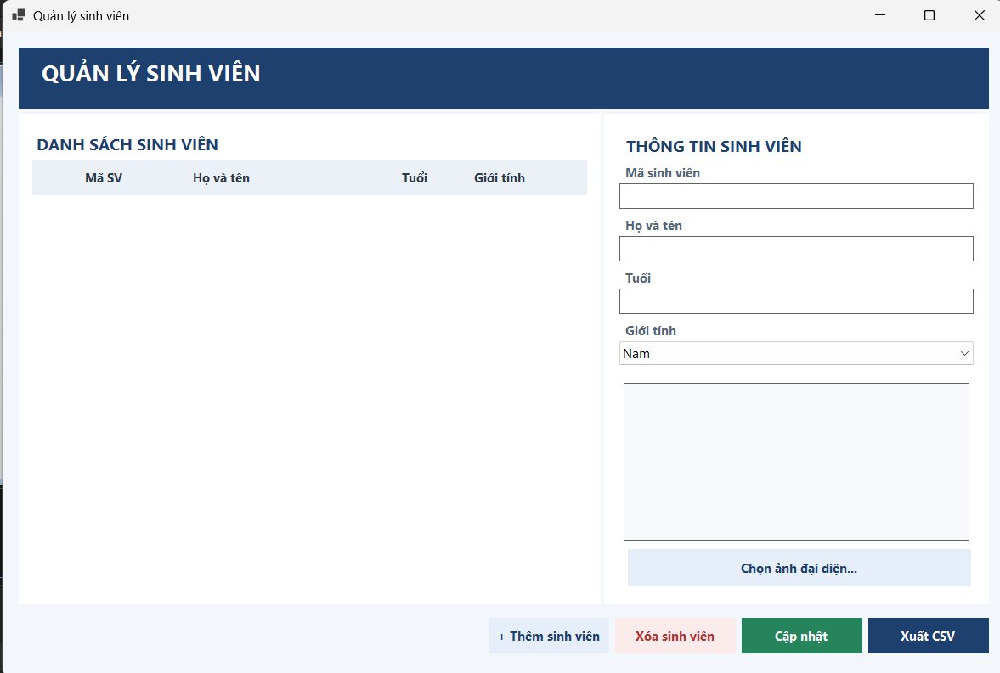
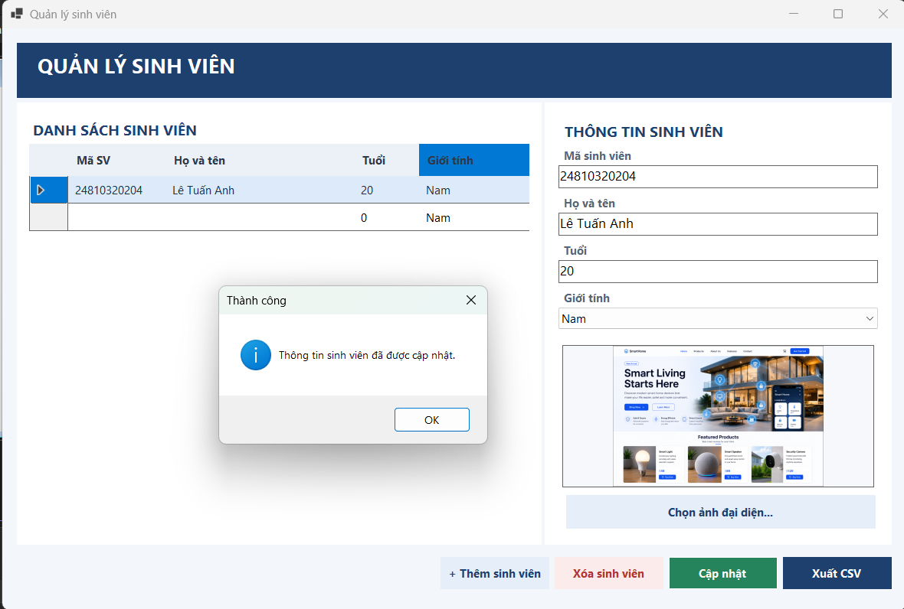
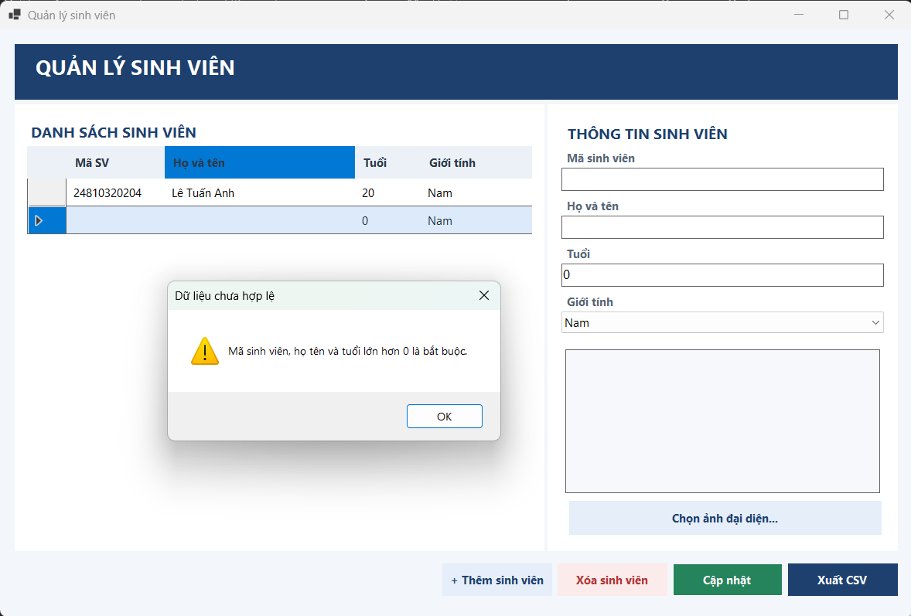
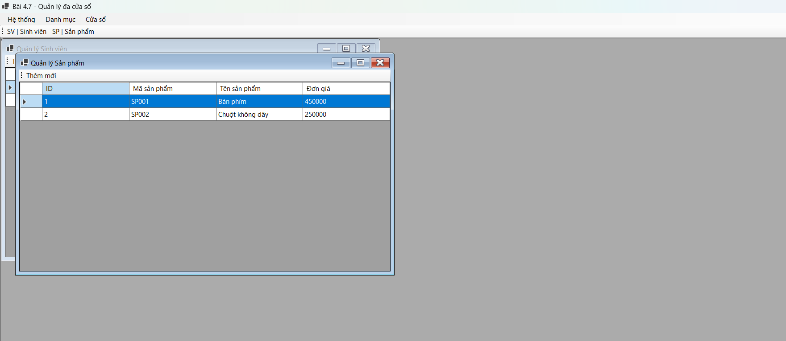
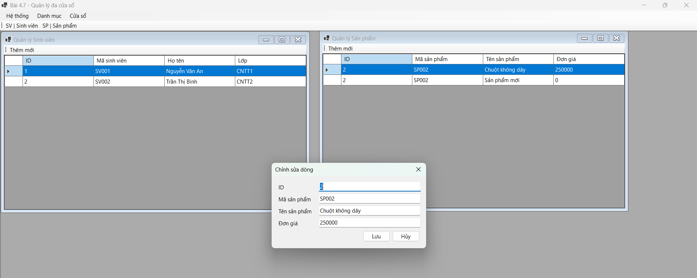
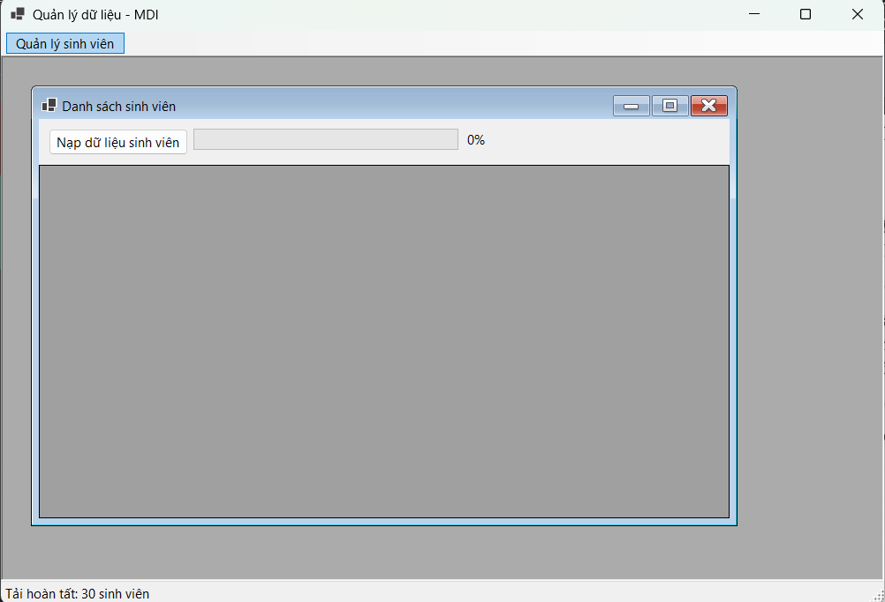
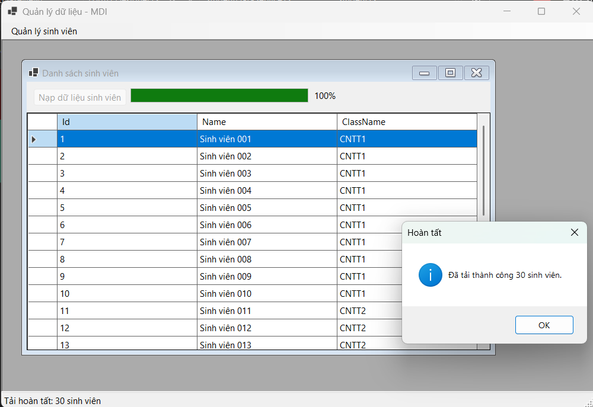

# BÁO CÁO BÀI TẬP / ĐỒ ÁN

## THÔNG TIN SINH VIÊN
- **Họ và tên:** Lê Tuấn Anh
- **Mã số sinh viên:** 24810320204
- **Lớp:** D19QTANM1
- **Tên môn học:** Lập trình.net / Windows Forms
- **Tên bài tập:** [BT 4.6-4.7-4.8]

---

## KẾT QUẢ THỰC HÀNH

---
Bài4.6
### 1. Ảnh màn hình Giao diện chính

### 2. Ảnh màn hình Chức năng thực thi / Kết quả

4.6.png)
4.6.png)

### 3. Ảnh màn hình Kiểm tra lỗi (Validation)

---
Bài4.7
### 1. Ảnh màn hình Giao diện chính

### 2. Ảnh màn hình Chức năng thực thi / Kết quả

---
Bài4.8
### 1. Ảnh màn hình Giao diện chính

### 2. Ảnh màn hình Chức năng thực thi / Kết quả

.png)
